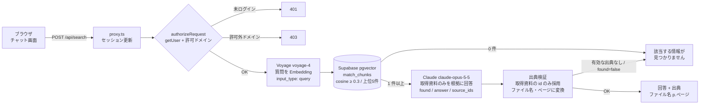
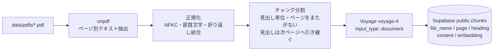

# 社内文書検索AI（案件3 / RAG）

社内規程 PDF を根拠に回答するチャットアプリ。回答には **出典のファイル名とページ番号** を表示し、文書に根拠がなければ **「該当する情報が見つかりません」** と答える。ログインしたユーザーだけが利用でき、未認証の検索 API 呼び出しは拒否する。

| 層 | 採用 |
|---|---|
| 画面・API | Next.js 16（App Router / Route Handler / `src/proxy.ts`） |
| 認証 | Supabase Auth（メール＋パスワード、許可ドメインは `ALLOWED_EMAIL_DOMAINS`） |
| ベクトル検索 | Supabase pgvector（`vector(1024)`、HNSW / cosine） |
| Embedding | Voyage AI `voyage-4`（1024 次元、文書 `input_type: "document"` / 質問 `"query"`） |
| 回答生成 | Claude API `claude-opus-5-5`（構造化出力、effort `medium`） |

## 目次

1. [構成図](#構成図)
2. [操作手順](#操作手順)
3. [動作確認](#動作確認)
4. [評価結果](#評価結果2026-11-14-実施)
5. [設計とセキュリティ](#設計とセキュリティ)
6. [Phase2 提案](#phase2-提案)
7. [ディレクトリ構成・開発の進め方](#ディレクトリ構成)

## 構成図

### 質問から回答まで



### PDF 取り込み（`npm run ingest -- --yes`）



Embedding がすべて成功してから、ファイル単位で「削除 → 追加」する（再実行しても重複しない。途中で失敗しても既存データは消えない）。

## 操作手順

### 前提

- Node.js 24 / npm 11
- Supabase プロジェクト（案件3専用、Region: Northeast Asia (Tokyo)）
- Voyage AI と Anthropic（Claude Console）の API キー

### 1. 依存関係のインストールと教材の配置

```bash
npm ci
```

講座提供の教材（PDF 5 本・テスト質問 CSV）は再配布しないためリポジトリに含めていない。配置方法は [`data/README.md`](data/README.md) を参照。

```bash
mkdir -p data/pdfs data/eval/raw
cp <配布フォルダ>/case3-doc*.pdf data/pdfs/
cp <配布フォルダ>/case3-test-questions.csv data/eval/raw/
npm run eval:fix-csv   # 5・6 番の列ずれを補正して data/eval/test-questions.csv を生成
```

### 2. Supabase の準備

1. 新規プロジェクトを作成する（作成時の設定: Enable Data API = ON / Automatically expose new tables = OFF / Enable automatic RLS = ON）。
2. SQL Editor に `supabase/migrations/0001_init.sql` を貼り付けて実行する。最後の確認 SELECT で `rls_enabled = true`、`anon_*`・`authenticated_*` がすべて `false`、`service_role_*` がすべて `true` であることを確認する。
3. Authentication の設定
   - Sign In / Providers で Email を有効にする。
   - 利用者は Users > Add user で作成する（Auto Confirm User にチェック）。
   - 画面からの新規登録を使わない場合は「Allow new users to sign up」をオフにする（[既知の制約](#既知の制約)参照）。
   - URL Configuration の Site URL を `http://localhost:3000` にする。

### 3. 環境変数

```bash
cp .env.example .env.local   # .env.local は Git 管理外
```

| 変数 | 内容 | 取得元 |
|---|---|---|
| `NEXT_PUBLIC_SUPABASE_URL` | Project URL | Supabase > Project Settings > Data API |
| `NEXT_PUBLIC_SUPABASE_PUBLISHABLE_KEY` | Publishable key（`sb_publishable_…`） | Supabase > Project Settings > API Keys |
| `SUPABASE_SECRET_KEY` | Secret key（`sb_secret_…`）。**`NEXT_PUBLIC_` を付けない** | 同上 |
| `ALLOWED_EMAIL_DOMAINS` | ログインを許可するメールドメイン（カンマ区切り、`@` なし） | 運用で決める |
| `VOYAGE_API_KEY` | Voyage AI の API キー | Voyage AI ダッシュボード |
| `ANTHROPIC_API_KEY` | Claude API キー | Claude Console |
| `RAG_CLAUDE_EFFORT` | 任意。回答生成の effort（既定 `medium`） | — |
| `RAG_MATCH_THRESHOLD` / `RAG_MATCH_COUNT` | 任意。検索しきい値（既定 `0.3`）/ 件数（既定 `5`） | — |

設定の確認（値は表示しない）:

```bash
npm run check:env   # 入力漏れ・形式・Supabase 接続・権限（anon からは読めないこと）
npm run check:ai    # Voyage / Claude に短いダミーテキストで 1 回ずつ接続
```

### 4. PDF の取り込み

```bash
npm run ingest            # 取り込み計画の表示のみ（API・DB に触れない）
npm run ingest -- --yes   # Embedding を作成して保存（5 ファイル / 34 チャンク）
npm run check:ingest      # DB の内容を PDF と照合（読み取りのみ）
```

Voyage の無料枠（支払い方法未登録）は RPM が小さいため、429 のときは 20 → 40 → 80 → 160 秒待って再試行する。失敗したファイルだけ `npm run ingest -- --yes --file <ファイル名>` で取り込み直せる。

### 5. 起動と利用

```bash
npm run dev   # http://localhost:3000
```

1. `http://localhost:3000/login` で、許可ドメインのアカウントでログインする。
2. チャット欄に質問を入力して送信する（例: 「有給休暇は何日もらえますか？」）。
3. 回答の下に「出典: ファイル名 p.ページ（見出し）」が表示される。文書にない質問には「該当する情報が見つかりません」と表示される。

### 6. テストと評価

```bash
npm test            # 単体テスト（キー不要。教材を使うテストは配置時のみ実行）
npm run typecheck
npm run lint
npm run eval        # 12 問評価（Voyage・Claude を各最大 12 回呼ぶ。約 4〜5 分）
```

その他: `npm run ingest:dry`（分割結果の確認）、`npm run eval:fix-csv`（教材 CSV の補正を再生成）、`npm run check:search`（検索経路とダミー資料での回答の最小確認）。

## 動作確認

| 確認内容 | 結果 |
|---|---|
| ブラウザ: 有給休暇の質問 | 回答と出典のファイル名・ページ番号が表示された（2026-11-14 確認） |
| ブラウザ: 退職金の質問 | 「該当する情報が見つかりません」と表示された（2026-11-14 確認） |
| 未ログインで `POST /api/search` | 401「ログインが必要です」（偽の cookie でも 401） |
| 未ログインで `/` | `/login` へリダイレクト |
| Publishable key（anon）で `chunks` / `match_chunks` | permission denied |
| ブラウザ向けビルド成果物（`.next/static`） | Secret key・Voyage・Anthropic のキーを含まない |

## 評価結果（2026-11-14 実施）

### 対象データ

| ファイル | ページ | チャンク |
|---|---|---|
| case3-doc1-employment-rules.pdf | 2 | 6 |
| case3-doc2-expense-manual.pdf | 2 | 7 |
| case3-doc3-security-policy.pdf | 2 | 7 |
| case3-doc4-remote-work.pdf | 1 | 6 |
| case3-doc5-it-onboarding.pdf | 2 | 8 |
| **合計 5 ファイル** | **9** | **34** |

テスト質問: 講座提供の CSV 12 問（答えあり 10 問 + 答えなし 2 問）。教材 CSV は 5・6 番の「期待される回答」が金額のカンマ（3,000円 / 5,000円）で 2 列に分かれていたため、結合して 6 列にそろえた。

### 評価時の設定

| 項目 | 値 |
|---|---|
| 回答モデル | `claude-opus-5-5`（構造化出力、`fallbacks: "default"`） |
| 思考の深さ（effort） | `medium`（`RAG_CLAUDE_EFFORT` の既定値） |
| Embedding | `voyage-4` / 1024 次元 |
| 検索 | cosine 類似度しきい値 `0.3` / 上位 `5` 件 |
| 応答時間の目標 | 5 秒以内 |

> 評価実行時、アプリは `CLAUDE_EFFORT` を読んでおり、Claude Code が環境に設定していた `medium` で動作していた。
> その後、変数名を `RAG_CLAUDE_EFFORT` に変更し、既定値を評価時と同じ `medium` にした（実効設定は変わらない）。

### 結果

| 指標 | 結果 |
|---|---|
| 答えがある 10 問の正答 | **10 / 10** |
| 答えがない 2 問の「該当なし」 | **2 / 2** |
| 出典ファイル名の正しさ | **10 / 10** |
| 出典ページ番号の正しさ | **10 / 10** |
| 応答時間 5 秒以内 | **12 / 12**（最小 1,830 / 中央値 2,372 / p90 2,861 / 最大 4,083 ms） |
| 未評価（429）・エラー | なし |

| 問 | 判定 | 応答時間 | 上位類似度 | 出典 |
|---|---|---|---|---|
| 1 有給休暇 | ○ | 4,083 ms | 0.620 | doc1 p.1 |
| 2 締め日・振込日 | ○ | 2,322 ms | 0.553 | doc2 p.1 |
| 3 リモートワーク日数 | ○ | 2,238 ms | 0.641 | doc4 p.1 |
| 4 パスワード | ○ | 2,595 ms | 0.669 | doc3 p.1 |
| 5 在宅勤務手当 | ○ | 2,295 ms | 0.596 | doc4 p.1 / doc2 p.1, p.2 |
| 6 接待交際費 | ○ | 1,830 ms | 0.583 | doc2 p.1 |
| 7 PC 紛失時の報告 | ○ | 2,861 ms | 0.648 | doc3 p.1 |
| 8 コアタイム | ○ | 2,372 ms | 0.676 | doc4 p.1 |
| 9 アカウント発行 | ○ | 2,445 ms | 0.618 | doc5 p.2, p.1 |
| 10 時間外労働の上限 | ○ | 2,388 ms | 0.650 | doc1 p.1 |
| 11 育児休業（答えなし） | ○ 該当なし | 2,412 ms | 0.478 | なし |
| 12 退職金（答えなし） | ○ 該当なし | 2,201 ms | 0.331 | なし |

### 採点基準（評価実行前に固定・コミット済み）

- **正答**: 期待回答から抜き出した必須要素（`data/eval/key-facts.json`）がすべて回答に含まれる。NFKC・空白・カンマ・「か月/ヶ月」の表記ゆれは正規化して照合。
- **出典**: 引用ページがすべて「出典文書 × 出典セクション」のページに含まれ、かつ必須要素が載ったページを 1 つ以上含む。
- **該当なし**: `found=false`・回答が固定文言と完全一致・出典なし。
- **応答時間**: 質問 Embedding + 検索 + Claude 回答のサーバー内処理時間（HTTP・認証の往復、429 待機は含まない）。

### 所見（精度調整は未実施）

- 答えなし 2 問も上位類似度がしきい値 0.3 を超えたため Claude が呼ばれ、Claude 側で「該当なし」と判定した。答えあり 10 問の上位類似度は 0.553〜0.676。
- 1 問目のみ検索が 1.2 秒（初回接続）。2 問目以降は 0.1〜0.2 秒。
- 問題数が少ないため、しきい値の変更は評価データを増やしてから判断する。

評価結果の JSON（`data/eval/results/`）は教材の質問文を含むため公開リポジトリには含めていない。

## 設計とセキュリティ

- **ページ番号の正確さ**: チャンクはページをまたがない。見出しはページをまたいで引き継ぎ、Embedding 用テキストに「文書名 > 見出し」を前置する（例: 「4. アカウント申請の流れ」の続きが p.2 にあっても見出し付きで検索される）。
- **文字の正規化**: 教材 PDF は `⽇`（康煕部首）・`⻑`（部首補助）のような文字で出力されるため、NFKC＋個別マップで通常の漢字にそろえる。
- **根拠のない回答の防止**: 類似度しきい値を超える資料が 0 件なら Claude を呼ばない。Claude には取得資料だけを `<sources>` で渡し（資料内の命令文には従わない指示付き）、`found / answer / source_ids` の構造化出力で返させる。出典はサーバー側で「実際に取得した資料の id」だけを採用し、有効な出典がなければ「該当なし」にする。
- **認証・認可**: 本判定は API / ページ側の `authorizeRequest()`（`getUser()` でトークンをサーバー検証＋許可ドメイン）。`proxy.ts` は画面遷移用の楽観チェックのみ。許可ドメイン未設定時は誰もログインできない（fail-closed）。
- **DB 権限**: `chunks` は RLS 有効・ポリシーなし、`anon` / `authenticated` からは全権限を剥奪（TRUNCATE 含む）。`match_chunks` の実行権限も `service_role` のみ。読み書きは認可済みサーバーから Secret key 経由で行う。
- **秘密情報**: `.env.local` のみに保存（Git 管理外）。Secret key は `NEXT_PUBLIC_` を付けずサーバー専用。ログには質問文・キー・資料本文を出さない。
- **設定名の衝突回避**: 回答の effort はアプリ専用の `RAG_CLAUDE_EFFORT` を読む（`CLAUDE_EFFORT` は Claude Code が使う名前のため読まない）。

### 既知の制約

- **新規登録**: Supabase の「Allow new users to sign up」がオンだと、許可ドメインのメールアドレスを持つ人は誰でも登録できる。許可ドメインにフリーメールを指定する場合は、サインアップをオフにして利用者を Add user で作成すること。
- **Voyage 無料枠**: RPM が小さく、短時間に質問を続けると 429（画面では「混み合っています」）になることがある。
- **対象文書**: テキスト層のある PDF のみ（画像だけの PDF は OCR が必要）。

## Phase2 提案

| 優先 | 提案 | 内容 | 期待効果 |
|---|---|---|---|
| 高 | 文書管理画面 | 管理者が PDF をアップロード → Supabase Storage に保存 → 自動で取り込み。差し替え・削除・取り込み状況の表示 | 開発者なしで規程改定に追従できる |
| 高 | 出典から原文へ | 出典に PDF の該当ページへのリンク（Storage の署名付き URL）と該当箇所の抜粋を表示 | 回答の確認が速くなり、信頼性が上がる |
| 高 | 評価セットの拡充と継続評価 | 質問を 50 問以上に増やし（言い換え・複数文書・紛らわしい該当なし問題）、CI で定期実行。結果を見てしきい値・effort を校正 | 精度の劣化を検知し、調整の根拠を持てる |
| 中 | 検索精度の強化 | pgvector に全文検索（キーワード一致）を組み合わせたハイブリッド検索と、Voyage の rerank | 固有名詞・数値を含む質問の取りこぼしを減らす |
| 中 | 部署別のアクセス制御 | チャンクに公開範囲（全社・部署）を持たせ、ユーザーの所属で検索対象を絞る。SSO（Google Workspace 等）連携 | 機密度の高い規程も同じ仕組みで扱える |
| 中 | 回答体験 | 回答のストリーミング表示、会話の文脈を踏まえた追質問、👍/👎 フィードバック | 体感速度と満足度の向上、改善データの収集 |
| 中 | 運用・コスト管理 | 質問ログ（個人情報に配慮）・利用量・該当なし率のダッシュボード、ユーザー単位のレート制限 | 利用状況の把握と API コストの抑制 |
| 低 | 本番デプロイ | Vercel 等へのデプロイ、本番用 Supabase、CI（test / typecheck / lint / build） | 社内公開できる状態にする |

## ディレクトリ構成

```
data/README.md                教材の配置方法
data/pdfs/                    教材 PDF 5 本（Git 管理外・各自配置）
data/eval/raw/                教材 CSV 原本（Git 管理外・各自配置）
data/eval/test-questions.csv  補正済みテスト質問 12 問（Git 管理外・eval:fix-csv で生成）
data/eval/key-facts.json      採点用の必須要素
data/eval/results/            評価結果 JSON（Git 管理外）
supabase/migrations/          DB スキーマ（SQL Editor で適用）
scripts/                      取り込み・評価・接続確認スクリプト
src/proxy.ts                  セッション更新・未ログイン時のリダイレクト
src/app/login/                ログイン画面・Server Actions
src/app/Chat.tsx              チャット画面（回答・出典表示）
src/app/api/search/route.ts   検索 API（認可 → 入力検証 → 回答）
src/lib/auth/                 許可ドメイン判定・認可チェック・入力チェック
src/lib/ingest/               PDF 抽出・正規化・チャンク分割・保存
src/lib/embedding/voyage.ts   Voyage Embedding（文書=document / 質問=query、429 再試行）
src/lib/rag/                  検索（match_chunks）→ Claude 回答（構造化出力・出典検証）
src/lib/eval/                 テスト質問 CSV の補正・採点
src/lib/env.ts                環境変数（値は表示しない）
```

### 開発の進め方（git worktree）

main に共通部分（依存・型・スキーマ・Voyage クライアント）をコミットしてから、作業ツリーを分けて実装し、main に統合した。

| ブランチ | 内容 | 状態 |
|---|---|---|
| `feature/ingest` | PDF 取り込み（抽出 → 分割 → Embedding → 保存） | main に統合済み |
| `feature/search-api` | 検索・Claude 回答・API・チャット画面の接続 | main に統合済み |
| `feature/eval` | 12 問評価スクリプト・採点基準・結果 | main に統合済み |

```bash
git worktree add .worktrees/<name> -b feature/<name>
# 各 worktree で npm ci（評価など API を使う場合のみ .env.local をコピー。中身は表示しない）
```
